<!-- Cabeçalho -->
<p align="center">
  
</p>

<p align="center">
  
</p>

<p align="center">
  
  
</p>

---

### 👨‍💻 Quem sou

```ts
const nicolas = {
  papel: "Desenvolvedor Full Stack",
  atuacao: "Desenvolvimento e TI de um sistema de gestão clínica em produção",
  local: "Fortaleza, CE – Brasil",
  idiomas: ["Português (nativo)", "Inglês (técnico)"],
  foco: ["React + TypeScript", "Supabase / PostgreSQL", "Segurança e LGPD", "BI e indicadores"],
  agora: "Auditoria de documentos clínicos com IA",
};
```

Sou **Desenvolvedor Full Stack** e atuo em um sistema usado todos os dias por recepção, administrativo e profissionais de saúde. Cuido de tudo: a modelagem do banco e as regras de acesso, as funções no servidor e a tela que a pessoa usa. Gosto de transformar um pedido de uma equipe não técnica em uma funcionalidade simples de usar e segura para os dados de pacientes.

- 🏥 **1.200+ commits** em produção em 5 meses, em um sistema com 70+ edge functions
- 🔐 Aprofundando em **segurança de dados**, **Row Level Security** e **LGPD**
- 🤖 Uso **IA no dia a dia de desenvolvimento** e em funcionalidades do produto
- 💬 Pode me perguntar sobre **Supabase**, **RLS**, **React Query** ou **dashboards com Recharts**

---

### 🧰 Tecnologias

| Área | Ferramentas |
| :-- | :-- |
| **Front-end** |  |
| **Back-end e dados** |  |
| **DevOps e qualidade** |  |
| **Outras** |  |

Também uso: TanStack Query · React Hook Form · Zod · Radix UI · Recharts · TipTap · geração de PDF e DOCX · webhooks · integração com WhatsApp · Claude Code · Lovable

---

### 🚀 O que já construí

<details open>
<summary><b>📅 Agenda clínica</b> — React · Supabase · Edge Functions</summary>
<br>
Agenda multiprofissional com reagendamento, bloqueio automático de horários, sessões extras, avisos para a equipe e lembretes automáticos por WhatsApp antes das consultas.
</details>

<details>
<summary><b>📊 BI e indicadores</b> — PostgreSQL · Recharts</summary>
<br>
Painéis de agendamento, reagendamentos, NPS, funil clínico e prazo de entrega de relatórios. Os cálculos ficam em views e funções no banco, e as telas são feitas para quem não é da área técnica.
</details>

<details>
<summary><b>🤖 Auditoria de documentos com IA</b> — Edge Functions · LLM</summary>
<br>
Revisão automática de relatórios clínicos com prompt versionado, editável pela responsável técnica e validado contra um conjunto de casos de referência antes de entrar em uso.
</details>

<details>
<summary><b>🔐 Segurança e LGPD</b> — RLS · GitHub Actions · Vitest</summary>
<br>
Políticas de acesso por perfil no banco, recuperação de senha por código (e-mail + WhatsApp + captcha) e uma verificação automática no CI que bloqueia CPF, migration sem RLS e arquivos sensíveis antes de chegarem ao repositório.
</details>

<details>
<summary><b>🎫 Central de chamados</b> — React · Supabase</summary>
<br>
Sistema interno de suporte com prazo, responsável, histórico de alterações e validação da entrega por quem abriu o chamado.
</details>

<details>
<summary><b>🎓 Base acadêmica</b> — C</summary>
<br>
Estruturas de dados (listas encadeadas e afins) — repositórios da faculdade fixados abaixo.
</details>

---

### 📈 Atividade

<p align="center">
  
</p>

---

### 🧭 Como eu trabalho

<p align="center">
  <i>"Escrevo cada tela pensando em quem vai usá-la às 7h da manhã, com a recepção cheia e o paciente esperando."</i>
</p>

<p align="center">
  
</p>
